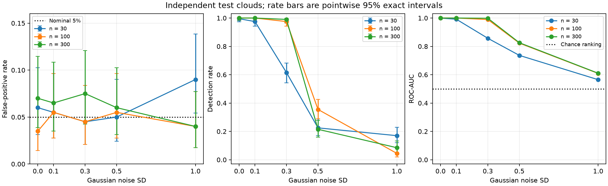
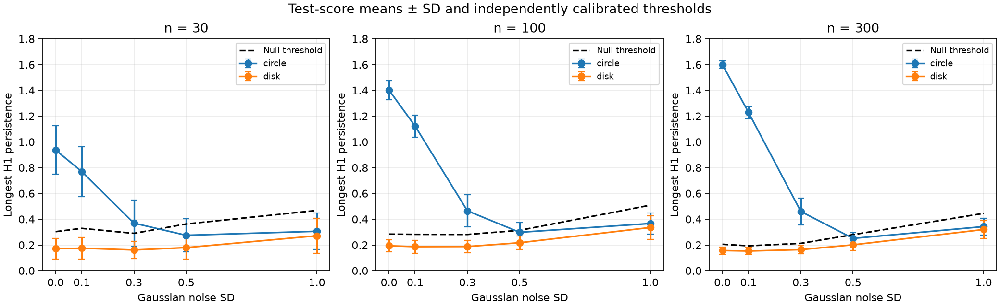

# When does longest persistence detect a circle?

At noise 1.0, persistence increased in both circles and disks. We test whether
the longest interval can still distinguish them, using a threshold chosen
from separate disk samples.

## Design

We sample angles uniformly on a unit circle and points uniformly by area in
a disk, then add independent Gaussian noise to each coordinate. The clean
circle has one hole; the disk has none. These labels describe the clean shapes:
nonzero Gaussian noise gives both distributions support throughout the plane.

The score is the longest finite H1 persistence, or zero if none exists.
Ripser uses Euclidean distance, H0/H1, coefficients modulo 2, and no cutoff or
subsampling. We test 30, 100, and 300 points at noise SD 0, 0.1, 0.3, 0.5, and
1.0, relative to unit radius. Each of the 15 conditions uses:

- 199 disk simulations to calibrate the threshold;
- 200 new disks to estimate false-positive rate (FPR);
- 200 new circles to estimate detection rate (sensitivity).

All 8,985 simulations use different seeds, starting at 424242.
The threshold and test samples are independent.

For each condition, sort its calibration scores and use the 190th smallest as
threshold: $k=\lceil(199+1)(1-0.05)\rceil=190$. Detect only when a test score
is strictly greater than this threshold. For independent disk samples, this
rule gives at most 5% false positives on average over calibration and new test
samples; an individual threshold can give a higher rate [1]. We do not adjust
thresholds using the test results.

ROC-AUC uses the unthresholded test scores: it measures how often a circle
ranks above a disk, counting ties as half [2]. Rate plots show pointwise 95%
Clopper–Pearson intervals conditional on the fitted threshold [3]; AUC values
are point estimates.

## Results

| Points | Noise | Detection | FPR | ROC-AUC |
|---|---|---|---|---|
| 30 | 0.0 | 99.5% | 6.0% | 0.999 |
| 30 | 0.1 | 97.5% | 5.5% | 0.992 |
| 30 | 0.3 | 61.5% | 4.5% | 0.857 |
| 30 | 0.5 | 22.5% | 5.0% | 0.736 |
| 30 | 1.0 | 17.0% | 9.0% | 0.565 |
| 100 | 0.0 | 100.0% | 3.5% | 1.000 |
| 100 | 0.1 | 100.0% | 5.5% | 1.000 |
| 100 | 0.3 | 97.5% | 4.5% | 0.989 |
| 100 | 0.5 | 35.5% | 5.5% | 0.823 |
| 100 | 1.0 | 4.5% | 4.0% | 0.609 |
| 300 | 0.0 | 100.0% | 7.0% | 1.000 |
| 300 | 0.1 | 100.0% | 6.5% | 1.000 |
| 300 | 0.3 | 99.0% | 7.5% | 0.999 |
| 300 | 0.5 | 21.5% | 6.0% | 0.826 |
| 300 | 1.0 | 8.5% | 4.0% | 0.611 |

Detection is strong at noise 0–0.1 for all three sample sizes. At noise 0.3,
100 points give 97.5% detection (95% interval 94.3–99.2%) and 4.5% FPR
(2.1–8.4%); 30 points detect only 61.5%. Thus denser sampling helps at moderate
noise, but detection remains poor at noise 0.5 or 1.0 even with 300 points.

At noise 0.5, AUC remains 0.823–0.826 for 100–300 points, yet detection is only
21.5–35.5% at the chosen thresholds. The scores can rank circles above disks
without detecting many circles at a threshold that limits false positives. At noise 1.0,
AUC falls to 0.565–0.611 and detection is weak for every sample size.

For 100 points, mean circle persistence rises from 0.298 at noise 0.5 to 0.366
at noise 1.0, but mean disk persistence also rises from 0.217 to 0.335.
The null threshold rises from 0.313 to 0.509, while detection falls from 35.5%
to 4.5%. Higher persistence here does not make circles easier to detect.

## Interpretation and limits

The longest interval is a useful detector in these low-noise settings, and at
noise 0.3 with sufficiently dense sampling. It becomes unreliable at higher
noise: sampling gaps and spatial spread can produce long intervals in disks
too. More points do not always improve detection, and we do not track which
loop produces the longest interval.

The threshold assumes a known radius, noise level, sample size, and disk model.
The results apply to these two shapes and do not establish a general test for
holes. A different scale, noise level, or sampling density needs a new threshold.

Observed FPRs range from 3.5% to 9.0%. For 30 points at noise 1.0, the 9.0%
FPR has interval 5.4–13.9%, so the 5% target should not be read as a guarantee
for each threshold. We used one calibration set per condition. The intervals
measure uncertainty from the test samples, not from choosing a different
calibration set, and apply separately to each condition. Repeating calibration
would help check how much the threshold varies.

## References

1. Angelopoulos and Bates (2021). [A Gentle Introduction to Conformal Prediction and Distribution-Free Uncertainty Quantification](https://arxiv.org/abs/2107.07511).
2. [scikit-learn ROC-AUC documentation](https://scikit-learn.org/stable/modules/generated/sklearn.metrics.roc_auc_score.html).
3. [SciPy binomial proportion intervals](https://docs.scipy.org/doc/scipy/reference/generated/scipy.stats._result_classes.BinomTestResult.proportion_ci.html).
4. [Ripser API](https://ripser.scikit-tda.org/en/latest/reference/stubs/ripser.ripser.html).
