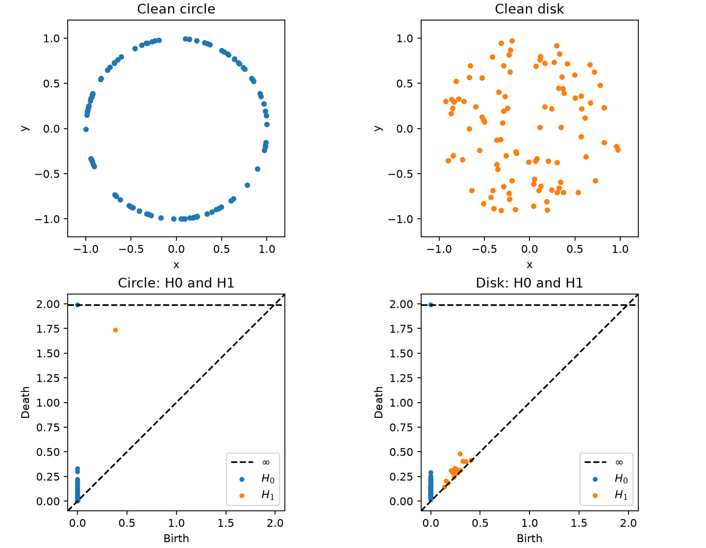
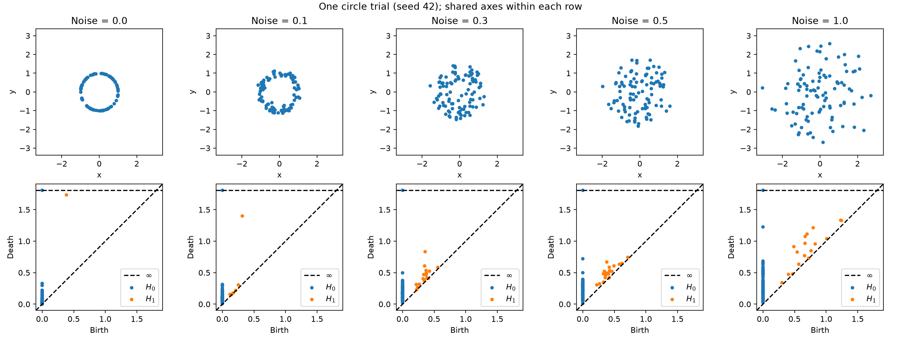
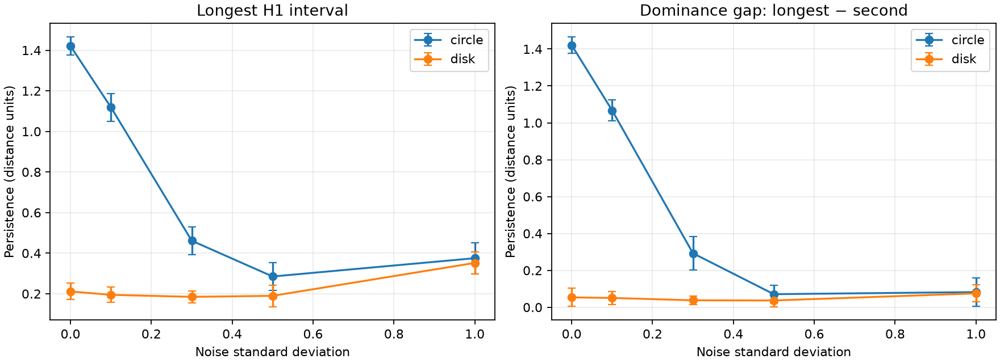
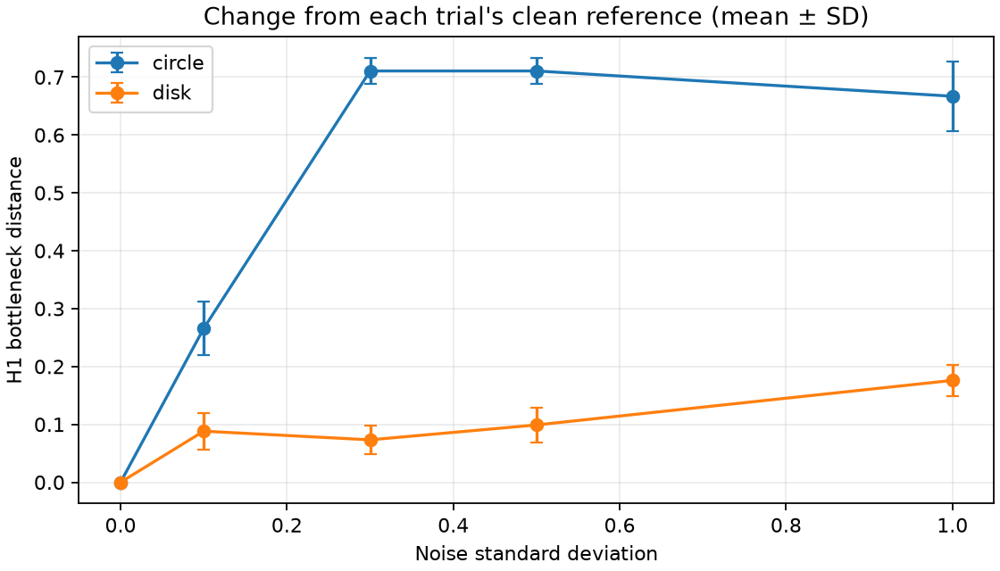
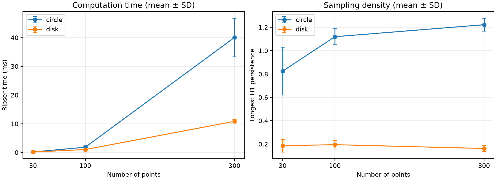

# Can the longest persistence interval identify a noisy circle?

Does the longest $H_1$ interval distinguish a noisy circle from a filled disk?
We expect a dominant interval for the clean circle, weaker separation under
noise, and more consistent results with denser sampling.

## Method

Ripser computes Vietoris–Rips persistence; Persim plots and compares diagrams.
A simplex appears when all its pairwise distances are at most the threshold.
As this threshold grows, $H_0$ tracks components and $H_1$ tracks loops.
A feature born at $b$ and dying at $d$ has persistence $d-b$ [1, 2].

We record the two longest intervals, their difference (dominance gap), and
interval count—not the number of significant holes. Bottleneck distance
minimizes the largest $L_\infty$ matching cost, allowing diagonal matches [4].
Each noisy diagram is compared with its own clean reference.

We sample unit-circle angles uniformly and scale radii by $\sqrt{U}$,
$U\sim\mathrm{Uniform}(0,1)$, for a uniform-area disk. Noise is $\sigma Z$,
with independent standard Gaussian coordinates. Shapes share angles and noise
within each seed; scaling the same noise array across levels gives paired trials.

| Setting | Value |
|---|---|
| Noise study | 100 points; noise SD 0, 0.1, 0.3, 0.5, 1.0 |
| Repeats | Seeds 42–51; two shapes; 100 clouds |
| Ripser | Euclidean distance, H0/H1, coefficients modulo 2, no cutoff or subsampling [3] |
| Density study | 30, 100, 300 points at noise 0.1; both shapes and all 10 seeds |
| Summaries | Mean ± sample SD across seeds, not confidence intervals |

To check scale, we divide the longest persistence by RMS radius,
$\sqrt{n^{-1}\sum_i\lVert x_i-\bar{x}\rVert^2}$.

## Results

### Clean shapes

Mean longest persistence is 1.421 ± 0.045 for the circle and 0.212 ± 0.040 for
the disk; the circle is larger in all 10 pairs. Mean dominance gaps are 1.421
and 0.054, respectively, consistent with one strong circle feature and shorter
features from disk sampling gaps. The figure shows seed 42 on shared axes.

### Noise

For seed 42, longest persistence falls from 1.350 without noise to 0.289 at
noise 0.5, then rises to 0.424 at noise 1.0. The second-longest interval at
noise 1.0 is 0.418, so the leading feature barely stands out.

| Noise | Circle longest, mean ± SD | Disk longest, mean ± SD | Circle larger in paired trials |
|---|---|---|---|
| 0.0 | 1.421 ± 0.045 | 0.212 ± 0.040 | 10/10 |
| 0.1 | 1.119 ± 0.069 | 0.195 ± 0.038 | 10/10 |
| 0.3 | 0.461 ± 0.068 | 0.185 ± 0.029 | 10/10 |
| 0.5 | 0.285 ± 0.068 | 0.190 ± 0.053 | 9/10 |
| 1.0 | 0.375 ± 0.076 | 0.352 ± 0.053 | 6/10 |

Both shapes show a high-noise increase. At noise 1.0 their mean persistence
values are close, as are their dominance gaps: 0.082 for the circle and 0.075
for the disk. The paired counts describe these samples, not classification
accuracy.

Circle persistence rises from noise 0.5 to 1.0 in 10/10 trials, with mean change
+0.090. After dividing by RMS radius, it rises in only 3/10 trials, with mean
relative change −0.016. Spatial spread may contribute to the rebound, but this
check does not establish its cause or show that the original loop survived.

Mean circle bottleneck distance reaches 0.711 at noise 0.3–0.5, then falls to
0.667 at noise 1.0. A feature can match the diagonal at half its persistence
[4], so the plateau near half the clean longest persistence, or the later
decrease, need not indicate recovery. Circle and disk use different clean
references, so their curve heights do not directly rank robustness.

### Sampling density and runtime

After one warm-up, we take the median of three timed Ripser calls per cloud,
including distance calculation and H0/H1 but excluding generation and plotting.
Samples at different sizes are not nested. At noise 0.1, increasing circle size
from 30 to 300 raises mean persistence from 0.824 to 1.222 and lowers SD from
0.204 to 0.056; disk means stay between 0.162 and 0.195. Runtime increases,
but three sizes cannot establish a complexity law.

| Points | Circle time, ms ± SD | Disk time, ms ± SD |
|---|---|---|
| 30 | 0.177 ± 0.008 | 0.160 ± 0.006 |
| 100 | 1.826 ± 0.283 | 1.019 ± 0.050 |
| 300 | 40.053 ± 6.708 | 10.845 ± 0.666 |

Times are means of per-cloud medians from the saved run: Python 3.11.17,
macOS 26.2, arm64. Reruns will have different timings; package versions and
settings are in [environment.json](results/environment.json).

## Evaluation and conclusion

Ripser's one-call calculation and Persim's compatible plotting and distance
functions make exploration straightforward. Interpretation remains the main
limitation: raw persistence depends on scale, and neither tool establishes
feature significance or survival of the original loop.

The shapes separate clearly at low noise, but much less at noise 1.0; the
rebound does not show recovery. Evidence covers only two synthetic shapes,
Gaussian noise, and small clouds, without memory or competitor benchmarks.
Next steps are to locate the measured features, test detection thresholds on
held-out samples, and evaluate other noise patterns and larger clouds,
including Ripser's subsampling option [3].

## References

1. Tralie, Saul, and Bar-On (2018). [Ripser.py: A Lean Persistent Homology Library for Python](https://joss.theoj.org/papers/10.21105/joss.00925).
2. Bauer (2021). [Ripser: efficient computation of Vietoris–Rips persistence barcodes](https://arxiv.org/abs/1908.02518).
3. [Ripser API documentation](https://ripser.scikit-tda.org/en/latest/reference/stubs/ripser.ripser.html).
4. [Persim documentation](https://persim.scikit-tda.org/en/latest/) and [bottleneck implementation](https://persim.scikit-tda.org/en/latest/_modules/persim/bottleneck.html).
